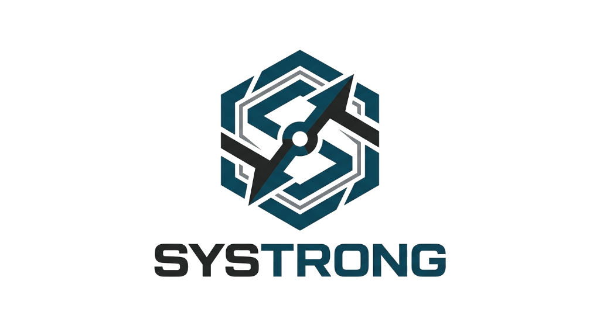

# ⚡ SYSTRONG — Sistema de Prescrição de Treinos & Acompanhamento Clínico (Cyberpunk Edition)

> ⚠️ **Aviso de segurança:** este projeto é um protótipo 100% client-side (HTML/CSS/JS
> estático, sem backend, sem banco de dados). A tela de login **não autentica de
> verdade** — qualquer usuário/senha entra — e todos os dados ficam em texto puro no
> `localStorage` do navegador, sem isolamento entre "pacientes" nem controle de acesso
> real. **Não use este sistema com dados reais de pacientes** enquanto não houver um
> backend com autenticação e autorização de verdade. Detalhes completos em
> [`docs/security-audit/relatorio-auditoria-seguranca.pdf`](docs/security-audit/relatorio-auditoria-seguranca.pdf).

**SYSTRONG** é uma plataforma web de alta tecnologia desenvolvida para personal trainers, fisioterapeutas e profissionais da saúde prescritores de treinos. O sistema combina estética **Cyberpunk Glassmorphism 2.0**, animações neurais dinâmicas e gerenciamento clínico integrado.



---

## 🚀 Funcionalidades Principais

- **🌌 Interface Cyberpunk Glassmorphism 2.0**:
  - Design futurista com iluminação neon (Ciano, Magenta, Verde Bio-Luminoso).
  - **Canvas Neural Interativo**: Rede de partículas 3D no fundo que reage ao movimento do cursor e cliques.
  - Tipografia de alta precisão usando as fontes Google **Orbitron**, **Rajdhani** e **Outfit**.
  - Suporte completo a **Dark Mode** e **Light Mode** com alternância instantânea.

- **⚡ Terminal Rápido de Sinais Vitais (Check-in Pós-Login)**:
  - Tela inicial rápida imediata após o login para registro instantâneo de sinais vitais.
  - **4 Campos Essenciais**: `SYS (mmHg)`, `DIA (mmHg)`, `PULSE (BPM)` e `PACIENTE`.
  - **Identificação Inteligente por Horário**: O sistema sugere e preenche automaticamente o paciente agendado para o horário mais próximo do relógio.
  - **Identificação por Nome Reduzido / ID Curto**: Reconhece apelidos ou abreviações (ex: `Luis H` -> `Luis Henrique da Silva`).
  - Gravação automática no prontuário e gráfico do aluno com classificação de segurança (Normal, Atenção, Risco).

- **💪 Prescrição & Programas de Treino**:
  - Criação de programas personalizados por objetivos (Reabilitação, Fortalecimento/Hipertrofia, Emagrecimento/Metabólico).
  - Organização por divisões de treino (A/B/C), séries, repetições, intervalos e cargas.

- **👥 Gestão Completa de Alunos & Pacientes**:
  - Fichas clínicas com anamnese, restrições médicas e arquivos/exames anexados.
  - Monitoramento de Pressão Arterial com gráfico vetorial SVG dinâmico.
  - Prontuário evolutivo cronológico.

- **🧮 Ferramentas Auxiliares & Medicina Científica**:
  - **Calculadora de IMC** (Índice de Massa Corporal) com classificação.
  - **Calculadora de TMB & TDEE** (Taxa Metabólica Basal e Gasto Calórico Diário).
  - **Pesquisa Integrada no NCBI PubMed**: Busca de literatura médica e científica em tempo real.
  - **Impressão de Relatórios Clínicos**: Layout otimizado para PDF e impressão (`@media print`).

---

## 🛠️ Tecnologias Utilizadas

- **HTML5 Semântico**
- **CSS3 Puro** (Glassmorphism 2.0, CSS Grid, Variáveis Globais, Animações Keyframes)
- **JavaScript ES6+** (Estado reativo, LocalStorage, Web Canvas 2D/3D API)

---

## 💻 Como Executar Localmente

Não é necessário instalar nada! Basta abrir o arquivo `index.html` em qualquer navegador web moderno:

```bash
# Ou inicie um servidor HTTP local simples com Python:
python -m http.server 8080
```
Acesse `http://localhost:8080` no seu navegador.

---

## 🌐 Como Colocar Online (Deploy Gratuito)

### Opção 1: GitHub Pages (Recomendado)
1. Crie um novo repositório no seu GitHub chamado `systrong`.
2. No terminal desta pasta, execute:
   ```bash
   git remote add origin https://github.com/bobmdy/systrong.git
   git push -u origin main
   ```
3. No GitHub, vá em **Settings** > **Pages** e selecione a branch `main`. Seu site estará no ar em segundos em:
   👉 **`https://bobmdy.github.io/systrong/`**

### Opção 2: Vercel / Netlify
1. Faça login na [Vercel](https://vercel.com) ou [Netlify](https://netlify.com).
2. Importe o repositório do GitHub ou simplesmente arraste a pasta do projeto para a interface web.

---

SYSTRONG © 2026 — TST Program. Todos os direitos reservados.
